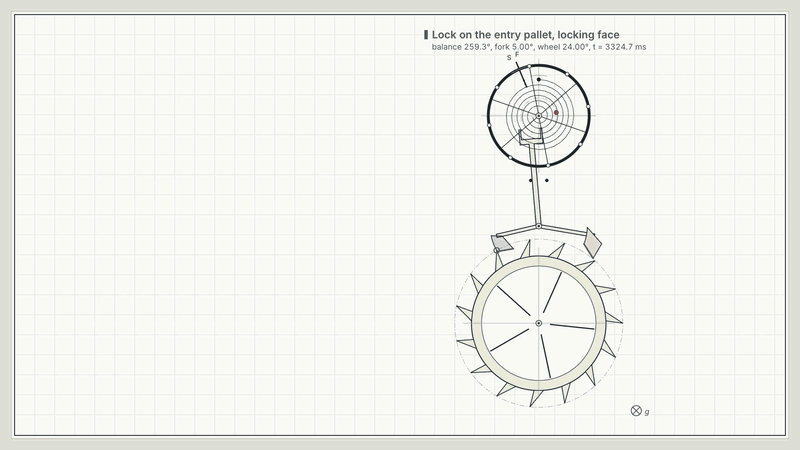

# The Watchmaker's Bench

Bartosz Ciechanowski's [Mechanical Watch](https://ciechanow.ski/mechanical-watch/) explains how a mechanical watch works. The Watchmaker's Bench picks up where that leaves off: it is about a watch that keeps bad time, and how you repair it. You work through a series of problems on a live, simulated movement, each one a watch with a fault to diagnose and regulate, reading a timegrapher (rate in s/day, amplitude in degrees, beat error in ms) the way a watchmaker does.

[](brag-output/brag.mp4)

*A 25-second tour (click for the full video with sound). Try it at https://watchmakers-bench.pages.dev. How the video was made: [`brag-output/`](brag-output/README.md).*

`watchmaker_brief.md` is the source of truth for concept and scope. `CLAUDE.md` carries decisions and working rules. `SPIKE.md` records the escapement spike that preceded this build.

## Development

Requires Node 22 or newer.

```sh
npm ci            # install (no browser downloads; Playwright browsers are fetched only by the verify-render skill)
npm run dev       # Vite dev server
npm run build     # tsc --noEmit, then vite build → dist/
npm run preview   # serve dist/ locally
npm test          # vitest run (sim core)
```

## Deployment

Static site on Cloudflare Pages. Pushing to `main` redeploys production; every other branch gets a preview URL. Agents deploy with the `deploy` skill (`.claude/skills/deploy/`): preview any branch any time, promote to `main` only on Akash's go-ahead. See `docs/hosting.md`, "Deploy process".

Production URL: https://watchmakers-bench.pages.dev
